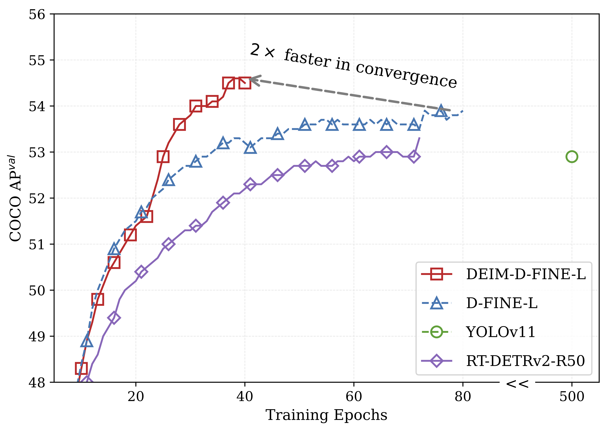
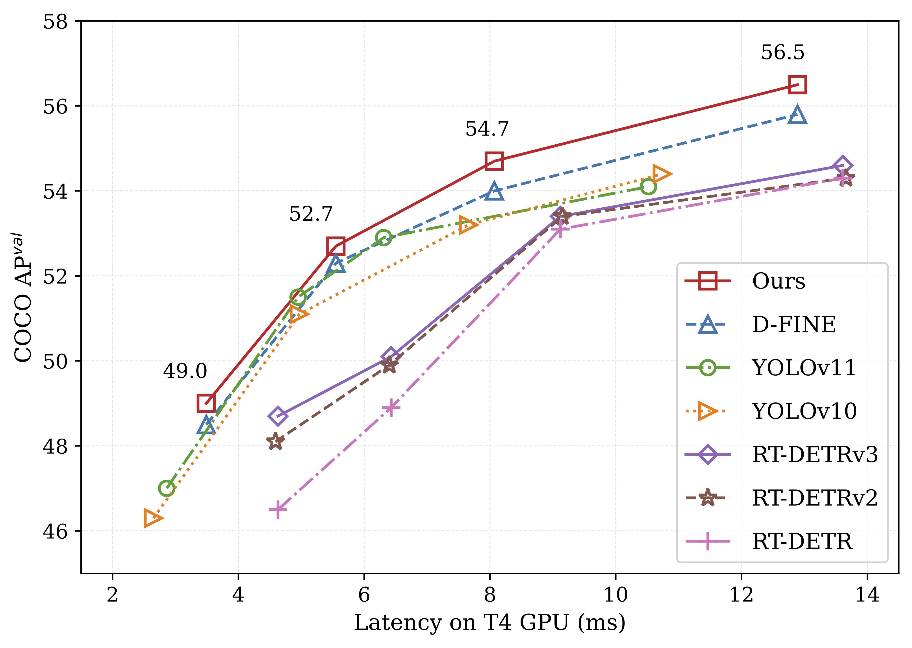

# Dense Single-type Detection

本仓库是在 [DEIM](https://github.com/ShihuaHuang95/DEIM) 基础上开展的密集单类别目标检测研究。训练入口、Python 包组织和 YAML 配置继承 DEIM 的原生根布局，即 `train.py`、`engine/`、`configs/` 与 `tools/`；这样可以继续使用 DEIM 的训练链路、配置继承和服务器命令，不额外套设会改变 import 或配置路径的源码目录。

## 当前研究方向

我们以表格单元格检测作为验证基座，研究两个训练层问题：固定 query 预算下的 **query selection–survival gap**，以及整框 IoU 共享权重无法按边表达短边尺度与同类邻域歧义。

当前 M-002 SGQS-E 已完成数学评审、代码实现和一次 epoch-27 单 seed
续训屏选：保留 SGQS 的候选监督，修正生存门槛与监督冲突，并加入邻域感知
的逐边 EFGL。当前状态为 `implemented / screened / unvalidated`；短续训信号
不等于正式数据集收益，M-001 和既有训练设计继续保留。

直接入口：[数学评审](article/methods/M-002_sgqs_e/math_review.md)、[修订公式](article/methods/M-002_sgqs_e/README.md)、[配置与验证](article/methods/M-002_sgqs_e/implementation.md)。四组配置位于 `configs/sgqs_e/`。

2026-10-13：B0--B3 七 epoch 核心矩阵及 C2 MAL-only 已完整归档。
B3 相对 B0 为 `+0.001020272` mAP，但 AP-small 为 `-0.003389557`；C2
总 mAP 最高但 AP-small 更低。单 seed、已收敛 checkpoint 续训不能证明稳定
收益、small-object 改善或方法互补性。见[完整结果跟进](article/experiments/EXP-TRAIN-005_epoch27-sgqs-e-resume-screen/diagnostics/20261013_b0_b3_c2_followup/README.md)、
[早期 B1/B2 诊断](article/experiments/EXP-TRAIN-005_epoch27-sgqs-e-resume-screen/diagnostics/20261013_b1_b2/README.md)
和[数学说明](article/experiments/EXP-TRAIN-005_epoch27-sgqs-e-resume-screen/diagnostics/20261013_b1_b2/math_diagnosis.md)。

2026-10-15：[SGQS 28+7 监督来源探针](article/experiments/EXP-TRAIN-006_sgqs-supervision-probes/README.md)
的 SGQS 与 B0 两臂均已完成 epoch 28--34。最终 mAP 分别为
`0.867590137` 与 `0.866675348`，但 SGQS 的 AP-small 为 `0.682273543`，
低于 B0 的 `0.683812615`。完整 checkpoint、8-rank 详细日志、resolved config、
运行 manifest 与 TensorBoard 已归档到 `outputs/probes/`；单 seed 短续训结果不等于
正式方法收益。

研究问题、实验记录、证据链和候选方法集中维护在 [`article/`](article/README.md)。仓库结构如下：

```text
train.py                         DEIM 风格的训练入口
engine/                          当前实际运行的模型、损失与数据链路
engine/sgqs/                     我们的训练期候选监督与损失实现
configs/                         当前实际运行的训练和评估配置
configs/sgqs/                    SGQS 正式配置与 checkpoint probe 配置
configs/sgqs_e/                  B0/B1/B2/B3 配对消融配置
tools/                           训练、推理、部署及表格任务脚本
tools/research/                  科研诊断、基准与证据维护工具
figures/                         DEIM 上游说明图
article/
├── journal/                     按日期增量记录科研进度
├── experiments/                 实验解释与结论边界
├── methods/                     候选方法推导及状态
└── docs/                        研究问题、证据索引与论文记录
output/, outputs/                日志、权重、派生数据与来源快照
```

`output/` 与 `outputs/` 是开发阶段的持久实验记录，日志、指标、配置快照和清单进入普通 Git，checkpoint、evaluator、TensorBoard 与归档等二进制由 Git LFS 管理。数据集及临时材料仍只放在 `_local/` 或外部存储；每项关键产物同时记录文件哈希和 Artifact ID。

---

<h2 align="center">
  Upstream foundation: DEIM — DETR with Improved Matching for Fast Convergence
</h2>

<p align="center">
    <a href="https://github.com/ShihuaHuang95/DEIM/blob/master/LICENSE">
        
    </a>
    <a href="https://arxiv.org/abs/2412.04234">
        
    </a>
   <a href="https://www.shihuahuang.cn/DEIM/">
        
    </a>
    <a href="https://github.com/ShihuaHuang95/DEIM/pulls">
        
    </a>
    <a href="https://github.com/ShihuaHuang95/DEIM/issues">
        
    </a>
    <a href="https://github.com/ShihuaHuang95/DEIM">
        
    </a>
    <a href="mailto:shihuahuang95@gmail.com">
        
    </a>
</p>

<p align="center" style="font-size: 2.0em; font-weight: bold;">
    🎉 <strong> <a href="https://intellindust-ai-lab.github.io/projects/EdgeCrafter/" style="color: #d9534f; text-decoration: none;">EdgeCrafter</a> is released with SOTA performance on detection, pose estimation as well as instance segmentation.</strong>🎉
</p>
<p align="center" style="font-size: 2.0em; font-weight: bold;">
    🎉 <strong>We’re excited to share <a href="https://intellindust-ai-lab.github.io/projects/DEIMv2/" style="color: #d9534f; text-decoration: none;">DEIMv2</a> </strong>🎉
</p>


<p align="center">
    DEIM is an advanced training framework designed to enhance the matching mechanism in DETRs, enabling faster convergence and improved accuracy. It serves as a robust foundation for future research and applications in the field of real-time object detection. 
</p>

---


<div align="center">
  <a href="http://www.shihuahuang.cn">Shihua Huang</a><sup>1</sup>,
  <a href="https://scholar.google.com/citations?user=tIFWBcQAAAAJ&hl=en">Zhichao Lu</a><sup>2</sup>,
  <a href="https://vinthony.github.io/academic/">Xiaodong Cun</a><sup>3</sup>,
  Yongjun Yu<sup>1</sup>,
  Xiao Zhou<sup>4</sup>, 
  <a href="https://xishen0220.github.io">Xi Shen</a><sup>1*</sup>
</div>

  
<p align="center">
<i>
1. Intellindust AI Lab &nbsp; 2. City University of Hong Kong &nbsp; 3. Great Bay University &nbsp; 4. Hefei Normal University
</i>
</p>

<p align="center">
  **📧 Corresponding author:** <a href="mailto:shenxiluc@gmail.com">shenxiluc@gmail.com</a>
</p>

<p align="center">
    <a href="https://paperswithcode.com/sota/real-time-object-detection-on-coco?p=deim-detr-with-improved-matching-for-fast">
    
    </a>
</p>

<p align="center">
<strong>If you like our work, please give us a ⭐!</strong>
</p>


<p align="center">
  
  
</p>

</details>

 
  
## 🚀 Updates
- [x] **\[2025.09.26\]** **DEIMv2** is now available with the [project page](https://intellindust-ai-lab.github.io/projects/DEIMv2/) and [release code](https://github.com/Intellindust-AI-Lab/DEIMv2). The series covers eight model sizes, from **X** down to **Atto**. For the **S, M, L, and X** variants, we leverage DINOv3 features (distilled or pretrained). **DEIMv2** achieves higher performance with fewer parameters and FLOPs.
- [x] **\[2025.06.24\]** DEIMv2 is coming soon: our next-gen detection series, along with three ultra-light variants: Pico (1.5M), Femto (0.96M), and Atto (0.49M), all delivering SoTA performance. Atto, in particular, is tailored for mobile devices, achieving 23.8 AP on COCO at 320×320 resolution.
- [x] **\[2025.03.12\]** The Object365 Pretrained [DEIM-D-FINE-X](https://drive.google.com/file/d/1RMNrHh3bYN0FfT5ZlWhXtQxkG23xb2xj/view?usp=drive_link) model is released, which achieves 59.5% AP after fine-tuning 24 COCO epochs.
- [x] **\[2025.03.05\]** The Nano DEIM model is released.
- [x] **\[2025.02.27\]** The DEIM paper is accepted to CVPR 2025. Thanks to all co-authors.
- [x] **\[2024.12.26\]** A more efficient implementation of Dense O2O, achieving nearly a 30% improvement in loading speed (See [the pull request](https://github.com/ShihuaHuang95/DEIM/pull/13) for more details). Huge thanks to my colleague [Longfei Liu](https://github.com/capsule2077).
- [x] **\[2024.12.03\]** Release DEIM series. Besides, this repo also supports the re-implmentations of [D-FINE](https://arxiv.org/abs/2410.13842) and [RT-DETR](https://arxiv.org/abs/2407.17140).

## Table of Content
* [1. Model Zoo](https://github.com/ShihuaHuang95/DEIM?tab=readme-ov-file#1-model-zoo)
* [2. Quick start](https://github.com/ShihuaHuang95/DEIM?tab=readme-ov-file#2-quick-start)
* [3. Usage](https://github.com/ShihuaHuang95/DEIM?tab=readme-ov-file#3-usage)
* [4. Tools](https://github.com/ShihuaHuang95/DEIM?tab=readme-ov-file#4-tools)
* [5. Citation](https://github.com/ShihuaHuang95/DEIM?tab=readme-ov-file#5-citation)
* [6. Acknowledgement](https://github.com/ShihuaHuang95/DEIM?tab=readme-ov-file#6-acknowledgement)
  
  
## 1. Model Zoo

### DEIM-D-FINE
| Model | Dataset | AP<sup>D-FINE</sup> | AP<sup>DEIM</sup> | #Params | Latency | GFLOPs | config | checkpoint
| :---: | :---: | :---: | :---: |  :---: | :---: | :---: | :---: | :---: 
**N** | COCO | **42.8** | **43.0** | 4M | 2.12ms | 7 | [yml](./configs/deim_dfine/deim_hgnetv2_n_coco.yml) | [ckpt](https://drive.google.com/file/d/1ZPEhiU9nhW4M5jLnYOFwTSLQC1Ugf62e/view?usp=sharing) |
**S** | COCO | **48.7** | **49.0** | 10M | 3.49ms | 25 | [yml](./configs/deim_dfine/deim_hgnetv2_s_coco.yml) | [ckpt](https://drive.google.com/file/d/1tB8gVJNrfb6dhFvoHJECKOF5VpkthhfC/view?usp=drive_link) |
**M** | COCO | **52.3** | **52.7** | 19M | 5.62ms | 57 | [yml](./configs/deim_dfine/deim_hgnetv2_m_coco.yml) | [ckpt](https://drive.google.com/file/d/18Lj2a6UN6k_n_UzqnJyiaiLGpDzQQit8/view?usp=drive_link) |
**L** | COCO | **54.0** | **54.7** | 31M | 8.07ms | 91 | [yml](./configs/deim_dfine/deim_hgnetv2_l_coco.yml) | [ckpt](https://drive.google.com/file/d/1PIRf02XkrA2xAD3wEiKE2FaamZgSGTAr/view?usp=drive_link) | 
**X** | COCO | **55.8** | **56.5** | 62M | 12.89ms | 202 | [yml](./configs/deim_dfine/deim_hgnetv2_x_coco.yml) | [ckpt](https://drive.google.com/file/d/1dPtbgtGgq1Oa7k_LgH1GXPelg1IVeu0j/view?usp=drive_link) | 


### DEIM-RT-DETRv2
| Model | Dataset | AP<sup>RT-DETRv2</sup> | AP<sup>DEIM</sup> | #Params | Latency | GFLOPs | config | checkpoint
| :---: | :---: | :---: | :---: |  :---: | :---: | :---: | :---: | :---: 
**S** | COCO | **47.9** | **49.0** | 20M | 4.59ms | 60 | [yml](./configs/deim_rtdetrv2/deim_r18vd_120e_coco.yml) | [ckpt](https://drive.google.com/file/d/153_JKff6EpFgiLKaqkJsoDcLal_0ux_F/view?usp=drive_link) | 
**M** | COCO | **49.9** | **50.9** | 31M | 6.40ms | 92 | [yml](./configs/deim_rtdetrv2/deim_r34vd_120e_coco.yml) | [ckpt](https://drive.google.com/file/d/1O9RjZF6kdFWGv1Etn1Toml4r-YfdMDMM/view?usp=drive_link) | 
**M*** | COCO | **51.9** | **53.2** | 33M | 6.90ms | 100 | [yml](./configs/deim_rtdetrv2/deim_r50vd_m_60e_coco.yml) | [ckpt](https://drive.google.com/file/d/10dLuqdBZ6H5ip9BbBiE6S7ZcmHkRbD0E/view?usp=drive_link) | 
**L** | COCO | **53.4** | **54.3** | 42M | 9.15ms | 136 | [yml](./configs/deim_rtdetrv2/deim_r50vd_60e_coco.yml) | [ckpt](https://drive.google.com/file/d/1mWknAXD5JYknUQ94WCEvPfXz13jcNOTI/view?usp=drive_link) | 
**X** | COCO | **54.3** | **55.5** | 76M | 13.66ms | 259 | [yml](./configs/deim_rtdetrv2/deim_r101vd_60e_coco.yml) | [ckpt](https://drive.google.com/file/d/1BIevZijOcBO17llTyDX32F_pYppBfnzu/view?usp=drive_link) | 


## 2. Quick start

### Setup

```shell
conda create -n deim python=3.11.9
conda activate deim
pip install -r requirements.txt
```


### Data Preparation

<details>
<summary> COCO2017 Dataset </summary>

1. Download COCO2017 from [OpenDataLab](https://opendatalab.com/OpenDataLab/COCO_2017) or [COCO](https://cocodataset.org/#download).
1. Modify paths in [coco_detection.yml](./configs/dataset/coco_detection.yml)

    ```yaml
    train_dataloader:
        img_folder: /data/COCO2017/train2017/
        ann_file: /data/COCO2017/annotations/instances_train2017.json
    val_dataloader:
        img_folder: /data/COCO2017/val2017/
        ann_file: /data/COCO2017/annotations/instances_val2017.json
    ```

</details>

<details>
<summary>Custom Dataset</summary>

To train on your custom dataset, you need to organize it in the COCO format. Follow the steps below to prepare your dataset:

1. **Set `remap_mscoco_category` to `False`:**

    This prevents the automatic remapping of category IDs to match the MSCOCO categories.

    ```yaml
    remap_mscoco_category: False
    ```

2. **Organize Images:**

    Structure your dataset directories as follows:

    ```shell
    dataset/
    ├── images/
    │   ├── train/
    │   │   ├── image1.jpg
    │   │   ├── image2.jpg
    │   │   └── ...
    │   ├── val/
    │   │   ├── image1.jpg
    │   │   ├── image2.jpg
    │   │   └── ...
    └── annotations/
        ├── instances_train.json
        ├── instances_val.json
        └── ...
    ```

    - **`images/train/`**: Contains all training images.
    - **`images/val/`**: Contains all validation images.
    - **`annotations/`**: Contains COCO-formatted annotation files.

3. **Convert Annotations to COCO Format:**

    If your annotations are not already in COCO format, you'll need to convert them. You can use the following Python script as a reference or utilize existing tools:

    ```python
    import json

    def convert_to_coco(input_annotations, output_annotations):
        # Implement conversion logic here
        pass

    if __name__ == "__main__":
        convert_to_coco('path/to/your_annotations.json', 'dataset/annotations/instances_train.json')
    ```

4. **Update Configuration Files:**

    Modify your [custom_detection.yml](./configs/dataset/custom_detection.yml).

    ```yaml
    task: detection

    evaluator:
      type: CocoEvaluator
      iou_types: ['bbox', ]

    num_classes: 777 # your dataset classes
    remap_mscoco_category: False

    train_dataloader:
      type: DataLoader
      dataset:
        type: CocoDetection
        img_folder: /data/yourdataset/train
        ann_file: /data/yourdataset/train/train.json
        return_masks: False
        transforms:
          type: Compose
          ops: ~
      shuffle: True
      num_workers: 4
      drop_last: True
      collate_fn:
        type: BatchImageCollateFunction

    val_dataloader:
      type: DataLoader
      dataset:
        type: CocoDetection
        img_folder: /data/yourdataset/val
        ann_file: /data/yourdataset/val/ann.json
        return_masks: False
        transforms:
          type: Compose
          ops: ~
      shuffle: False
      num_workers: 4
      drop_last: False
      collate_fn:
        type: BatchImageCollateFunction
    ```

</details>


## 3. Usage
<details open>
<summary> COCO2017 </summary>

1. Training
```shell
CUDA_VISIBLE_DEVICES=0,1,2,3 torchrun --master_port=7777 --nproc_per_node=4 train.py -c configs/deim_dfine/deim_hgnetv2_${model}_coco.yml --use-amp --seed=0
```

<!-- <summary>2. Testing </summary> -->
2. Testing
```shell
CUDA_VISIBLE_DEVICES=0,1,2,3 torchrun --master_port=7777 --nproc_per_node=4 train.py -c configs/deim_dfine/deim_hgnetv2_${model}_coco.yml --test-only -r model.pth
```

<!-- <summary>3. Tuning </summary> -->
3. Tuning
```shell
CUDA_VISIBLE_DEVICES=0,1,2,3 torchrun --master_port=7777 --nproc_per_node=4 train.py -c configs/deim_dfine/deim_hgnetv2_${model}_coco.yml --use-amp --seed=0 -t model.pth
```
</details>

<details>
<summary> Customizing Batch Size </summary>

For example, if you want to double the total batch size when training D-FINE-L on COCO2017, here are the steps you should follow:

1. **Modify your [dataloader.yml](./configs/base/dataloader.yml)** to increase the `total_batch_size`:

    ```yaml
    train_dataloader:
        total_batch_size: 64  # Previously it was 32, now doubled
    ```

2. **Modify your [deim_hgnetv2_l_coco.yml](./configs/deim_dfine/deim_hgnetv2_l_coco.yml)**. Here’s how the key parameters should be adjusted:

    ```yaml
    optimizer:
    type: AdamW
    params:
        -
        params: '^(?=.*backbone)(?!.*norm|bn).*$'
        lr: 0.000025  # doubled, linear scaling law
        -
        params: '^(?=.*(?:encoder|decoder))(?=.*(?:norm|bn)).*$'
        weight_decay: 0.

    lr: 0.0005  # doubled, linear scaling law
    betas: [0.9, 0.999]
    weight_decay: 0.0001  # need a grid search

    ema:  # added EMA settings
        decay: 0.9998  # adjusted by 1 - (1 - decay) * 2
        warmups: 500  # halved

    lr_warmup_scheduler:
        warmup_duration: 250  # halved
    ```

</details>


<details>
<summary> Customizing Input Size </summary>

If you'd like to train **DEIM** on COCO2017 with an input size of 320x320, follow these steps:

1. **Modify your [dataloader.yml](./configs/base/dataloader.yml)**:

    ```yaml

    train_dataloader:
    dataset:
        transforms:
            ops:
                - {type: Resize, size: [320, 320], }
    collate_fn:
        base_size: 320
    dataset:
        transforms:
            ops:
                - {type: Resize, size: [320, 320], }
    ```

2. **Modify your [dfine_hgnetv2.yml](./configs/base/dfine_hgnetv2.yml)**:

    ```yaml
    eval_spatial_size: [320, 320]
    ```

</details>

## 4. Tools
<details>
<summary> Deployment </summary>

<!-- <summary>4. Export onnx </summary> -->
1. Setup
```shell
pip install onnx onnxsim
```

2. Export onnx
```shell
python tools/deployment/export_onnx.py --check -c configs/deim_dfine/deim_hgnetv2_${model}_coco.yml -r model.pth
```

3. Export [tensorrt](https://docs.nvidia.com/deeplearning/tensorrt/install-guide/index.html)
```shell
trtexec --onnx="model.onnx" --saveEngine="model.engine" --fp16
```

</details>

<details>
<summary> Inference (Visualization) </summary>


1. Setup
```shell
pip install -r tools/inference/requirements.txt
```


<!-- <summary>5. Inference </summary> -->
2. Inference (onnxruntime / tensorrt / torch)

Inference on images and videos is now supported.
```shell
python tools/inference/onnx_inf.py --onnx model.onnx --input image.jpg  # video.mp4
python tools/inference/trt_inf.py --trt model.engine --input image.jpg
python tools/inference/torch_inf.py -c configs/deim_dfine/deim_hgnetv2_${model}_coco.yml -r model.pth --input image.jpg --device cuda:0
```
</details>

<details>
<summary> Benchmark </summary>

1. Setup
```shell
pip install -r tools/benchmark/requirements.txt
```

<!-- <summary>6. Benchmark </summary> -->
2. Model FLOPs, MACs, and Params
```shell
python tools/benchmark/get_info.py -c configs/deim_dfine/deim_hgnetv2_${model}_coco.yml
```

2. TensorRT Latency
```shell
python tools/benchmark/trt_benchmark.py --COCO_dir path/to/COCO2017 --engine_dir model.engine
```
</details>

<details>
<summary> Fiftyone Visualization  </summary>

1. Setup
```shell
pip install fiftyone
```
4. Voxel51 Fiftyone Visualization ([fiftyone](https://github.com/voxel51/fiftyone))
```shell
python tools/visualization/fiftyone_vis.py -c configs/deim_dfine/deim_hgnetv2_${model}_coco.yml -r model.pth
```
</details>

<details>
<summary> Others </summary>

1. Auto Resume Training
```shell
bash reference/safe_training.sh
```

2. Converting Model Weights
```shell
python reference/convert_weight.py model.pth
```
</details>


## 5. Citation
If you use `DEIM` or its methods in your work, please cite the following BibTeX entries:
<details open>
<summary> bibtex </summary>

```latex
@misc{huang2024deim,
      title={DEIM: DETR with Improved Matching for Fast Convergence},
      author={Shihua, Huang and Zhichao, Lu and Xiaodong, Cun and Yongjun, Yu and Xiao, Zhou and Xi, Shen},
      booktitle={Proceedings of the IEEE/CVF Conference on Computer Vision and Pattern Recognition},
      year={2025},
}
```
</details>

## 6. Acknowledgement
Our work is built upon [D-FINE](https://github.com/Peterande/D-FINE) and [RT-DETR](https://github.com/lyuwenyu/RT-DETR).

✨ Feel free to contribute and reach out if you have any questions! ✨
